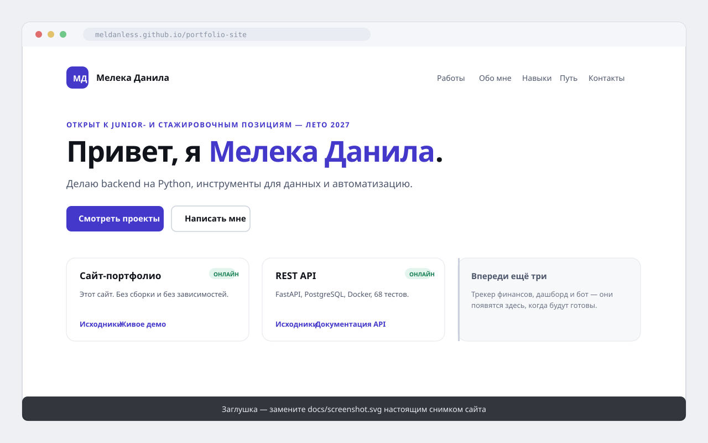

# Сайт-портфолио

[](https://github.com/MeldanLess/portfolio-site/actions/workflows/ci.yml)
[](https://github.com/MeldanLess/portfolio-site/actions/workflows/deploy.yml)


**Живое демо:** https://your-domain.com · **Исходники:** https://github.com/MeldanLess/portfolio-site

Личный сайт-портфолио на чистых HTML, CSS и JavaScript — без фреймворков, без
сборки, без runtime-зависимостей, без трекинга. Это хаб, который связывает все
остальные проекты, и первое, что открывает рекрутер.



---

## Задача

У портфолио одна работа: за минуту провести hiring manager от «кто это?» до
«хочу с ним поговорить». Большинство сайтов-портфолио проваливают её одним из
трёх способов:

1. **Они медленные.** Бандл фреймворка, веб-шрифт с чужого CDN и счётчик
   аналитики превращают страницу в 20 КБ в 2 МБ.
2. **Они ломаются.** Битая картинка или форма обратной связи, которая молча
   ничего не делает, выглядят хуже, чем сайта нет вообще.
3. **Они декоративны.** Красиво, но ничего не говорит о том, как работает
   человек.

Ограничение, которое из этого следует: **сайт должен быть быстрым, не должен
ломаться и должен делать остальную работу очевидной.**

---

## Что он умеет

- **Пять секций** — работы, обо мне, навыки, путь, контакты — каждая отвечает
  на вопрос, который рекрутер правда задаёт.
- **Светлая и тёмная темы**, по умолчанию следующие за системой и переключаемые
  одним кликом; выбор запоминается между визитами.
- **Полная адаптивность** — от телефона с шириной 320 px до широкого монитора.
- **Доступность с клавиатуры** — ссылка «перейти к содержимому», видимые фокусы,
  Esc закрывает мобильное меню, а переключатель темы — настоящая `<button>`.
- **Ноль сторонних запросов.** Ни CDN, ни веб-шрифтов, ни аналитики. Используется
  системный стек шрифтов, поэтому сайт выглядит родным на любой ОС и грузится
  мгновенно.
- **Деградирует корректно.** С выключенным JavaScript всё по-прежнему читается и
  все ссылки по-прежнему работают.

---

## Стек

| Слой | Выбор | Почему |
|---|---|---|
| Разметка | Семантический HTML5 | Это то, что понимают браузеры и скринридеры. |
| Стили | Современный CSS — кастомные свойства, grid, `clamp()` | Темизация становится подменой переменных; препроцессор не нужен. |
| Поведение | Vanilla JS, ~200 строк | Пять мелких возможностей не оправдывают ни фреймворк, ни сборщик. |
| Тесты | `node:test` + `node:assert` | Работают в уже установленном Node. Зависимостей нет. |
| Локальный сервер | `node:http` | Статическому сайту положен 60-строчный сервер, а не 60 МБ. |
| Хостинг | GitHub Pages, деплой из CI | Бесплатно, версионируется, и история сайта *является* историей репозитория. |

---

## Быстрый старт

Устанавливать ничего не нужно.

```bash
git clone https://github.com/MeldanLess/portfolio-site.git
cd portfolio-site
npm run serve
```

```
Отдаём .../portfolio-site/site
  -> http://localhost:3000
Нажмите Ctrl+C, чтобы остановить.
```

Затем откройте <http://localhost:3000>.

`npm run serve` запускает `scripts/serve.mjs` — маленький статический сервер с
корректными MIME-типами, страницей 404 и защитой от выхода за пределы каталога.
Каталога `node_modules` нет, потому что устанавливать нечего.

> Запуск прямо из файловой системы (`open site/index.html`) тоже работает — сайт
> намеренно не делает запросов `fetch()`, поэтому проблемы с CORS у него нет.
> Сервер нужен только для реалистичной локальной настройки.

---

## Структура проекта

```
portfolio-site/
├── site/                      # всё, что публикуется
│   ├── index.html
│   ├── 404.html
│   ├── robots.txt
│   ├── sitemap.xml
│   ├── .nojekyll              # запрещает GitHub Pages запускать Jekyll
│   ├── css/styles.css
│   ├── js/main.js
│   └── assets/
│       ├── favicon.svg
│       └── og-image.svg
├── scripts/
│   └── serve.mjs              # локальный сервер без зависимостей
├── tests/
│   └── site.test.mjs          # смоук-тесты
├── docs/
│   └── screenshot.svg         # заглушка вместо снимка экрана
├── .github/workflows/
│   ├── ci.yml                 # гоняет тесты при каждом пуше
│   └── deploy.yml             # публикует site/ в GitHub Pages
├── package.json
├── .gitignore
├── LICENSE
└── README.md
```

Опубликованный сайт целиком лежит в `site/`. Всё остальное — инструменты. Это
разделение и позволяет деплою остаться копированием, а не сборкой.

---

## Персонализация — сделано

Личные данные подставлены: имя, инициалы, почта и адрес сайта. Своего домена
нет и не планируется — сайт живёт на GitHub Pages, и его адрес
(`meldanless.github.io/portfolio-site`) и есть канонический. Ссылка на LinkedIn
не нужна: в России она заблокирована, а профиля hh.ru пока нет, — выдуманная
ссылка в контактах хуже, чем её отсутствие.

Плейсхолдеры больше не появятся молча: в корне репозитория лежит файл
`.personalised`, и с этого момента тест падает, если в публикуемой разметке
вернётся `Your Name`, `you@example.com`, `your-domain.com` или ссылка на
LinkedIn. Проверить руками:

```bash
grep -rn "your-domain.com\|your-\|you@example.com\|Your Name" site/
```

Ссылки на демо в карточках — отдельная история. Пока трекер и API не развёрнуты,
вторая ссылка ведёт в README репозитория («Как запустить», «Список эндпоинтов»):
ссылка в никуда на публичной странице — это ложь, которую посетитель проверит
кликом. Когда появится живой адрес, эти ссылки заменяются: «Как запустить» →
«Демо» у трекера, «Список эндпоинтов» → «Документация API» у API.

Затем замените карточки проектов в `site/index.html` на свои **законченные**
проекты. Карточка — это примерно 20 строк: заголовок, статус, один абзац, список
тегов, две ссылки.

> **Добавляете проект?** Добавьте его название в список `SHIPPED` в
> `tests/site.test.mjs`. Тест проверяет, что каждая карточка на странице ведёт в
> репозиторий, который уже выпущен, — поэтому карточка незаконченной работы
> роняет CI, а не тихо попадает в продакшен.

Два правила, которые не дают сайту врать:

- **Перечисляйте только законченную работу.** Карточка «скоро» — отрицательный
  сигнал. Добавляйте проект, когда его код готов, покрыт тестами и
  задокументирован, а не когда начат. Пока проект не задеплоен, ставьте метку
  «Код готов» (`.badge-code`) — она честнее, чем «Онлайн».
- **Ранжируйте карточки по силе, а не по дате.** Посетитель видит три из них.
  Пусть это будут три самых сильных.

Если используете свой домен, добавьте `site/CNAME` с одним только именем домена
и укажите домен в **Settings → Pages → Custom domain** репозитория.

---

## Тесты

```bash
npm test
```

Набор намеренно не про стили — CSS нельзя осмысленно покрыть юнит-тестами без
браузера. Он проверяет то, что действительно ломает статический сайт:

- все нужные файлы на месте;
- ровно один `<h1>`, заголовок, описание, viewport, язык;
- каждая ссылка в навигации ведёт в реальную секцию (`#work` → элемент с `id="work"`);
- каждый локальный `href`/`src` указывает на существующий файл;
- каждая карточка проекта ведёт в репозиторий, который **действительно выпущен** —
  страховка от карточки «скоро»;
- **нет внешних скриптов и стилей** — проникший CDN считается регрессией;
- нет аналитики и трекинга;
- `robots.txt` и `sitemap.xml` корректны;
- в JavaScript нет `eval` и `new Function`;
- у каждой `<button>` есть `type`, а переключатель мобильного меню объявляет
  `aria-expanded` и `aria-controls`.

Тесты гоняются в CI при каждом пуше и ещё раз непосредственно перед каждым
развёртыванием.

---

## Проектные решения и компромиссы

**Статические файлы вместо фреймворка.**
React или Next дали бы переиспользование компонентов — для страницы из пяти
секций и трёх карточек это переиспользование, которое не понадобится. Цена:
добавить проект — значит скопировать блок `<article>`. Выгода: весь сайт весит
60 КБ HTML и CSS, деплоится копированием, нечему ломаться из-за зависимости.
Для портфолио вторая колонка важнее первой.

**Тёмная тема через кастомные свойства, а не подменой таблицы стилей.**
Каждый цвет — это переменная (`--bg`, `--text`, `--accent`), поэтому светлая и
тёмная темы используют один набор правил. Тёмная палитра объявлена дважды —
один раз для явного выбора пользователя, второй внутри
`prefers-color-scheme`, — вместо более новой функции `light-dark()`, которой
нужны очень свежие браузеры. Портфолио, которое в старом браузере рендерится
без стилей, — это сломанное портфолио.

**Системные шрифты вместо веб-шрифта.**
`ui-sans-serif, system-ui, …` стоит ноль байт и ноль запросов и выглядит родно
на любой ОС. Веб-шрифт выглядел бы чуть «дизайнее» и стоил бы блокирующего
отрисовку запроса — плохой компромисс для сайта, чья идея — скорость.

**Без шага сборки.**
Репозиторий *является* сайтом. Задача деплоя копирует `site/` в Pages. Никакого
`npm ci`, никакого lockfile, который протухает, никакого конфига сборщика,
который надо понимать, и никакого шанса, что обновление зависимости сломает
деплой. Цена — отсутствие шаблонов: правка навигации означает правку
`index.html`. Для пяти секций этот компромисс верен.

**Набор тестов, который проверяет ссылки, а не пиксели.**
Визуальное регрессионное тестирование требует headless-браузера и эталонного
снимка на каждый коммит — тяжёлые инструменты ради страницы, которую и так видно.
Проверка ссылок и структуры ловит поломки, которые действительно случаются
(переименованный ресурс, удалённая секция, проникший CDN), и ничего не стоит.

**Анимация появления ограничена селектором `.js`.**
Элементы проявляются при попадании в область видимости, но скрытое состояние
применяется только после того, как JavaScript действительно выполнился. Если
скрипт не загрузится, ничего не останется невидимым. Есть и страховка: через
три секунды показывается всё независимо ни от чего.

---

## Что я изменил бы, если бы было больше времени

- **Управление контентом.** Сейчас, чтобы добавить проект, нужно править HTML.
  Небольшой JSON-файл плюс шаг сборки были бы удобнее — но только когда проектов
  станет больше десятка, и в тот момент я перешёл бы на Eleventy, а не стал бы
  изобретать собственную шаблонизацию.
- **Сгенерированное изображение для предпросмотра.** `assets/og-image.svg`
  нарисован вручную. Экспорт в PNG (с сохранением исходника) сделал бы
  превью одинаковыми в LinkedIn и Telegram.
- **Настоящие бюджеты производительности.** Сайт быстрый, но «быстрый» — это
  утверждение, пока оно не измерено. Lighthouse CI в workflow с бюджетом, который
  роняет сборку, превратили бы утверждение в гарантию.
- **Форма обратной связи с серверной валидацией.** Сейчас кнопка копирует
  адрес — без трения и без спама. Форма удобнее для части рекрутеров, но ей
  нужны бэкенд, защита от спама и политика конфиденциальности, поэтому её
  здесь сознательно нет.
- **Стиль для печати.** Текущие печатные правила — это только начало; по-настоящему
  печатаемое одностраничное резюме было бы хорошим дополнением.

---

## Заметки о доступности

- Семантические ориентиры (`header`, `nav`, `main`, `footer`) и один `h1` на страницу.
- Ссылка «перейти к содержимому» для работы с клавиатуры.
- Видимые контуры фокуса, которые выживают в обеих темах.
- Мобильное меню выставляет `aria-expanded` и `aria-controls`, закрывается по
  Esc и возвращает фокус кнопке.
- Подтверждение копирования — живая область (`aria-live="polite"`), поэтому
  скринридер его озвучивает.
- Контраст текста в обеих темах выдерживает требование 4.5:1.
- Вся анимация уважает `prefers-reduced-motion`.

## Лицензия

MIT — см. [LICENSE](LICENSE).
